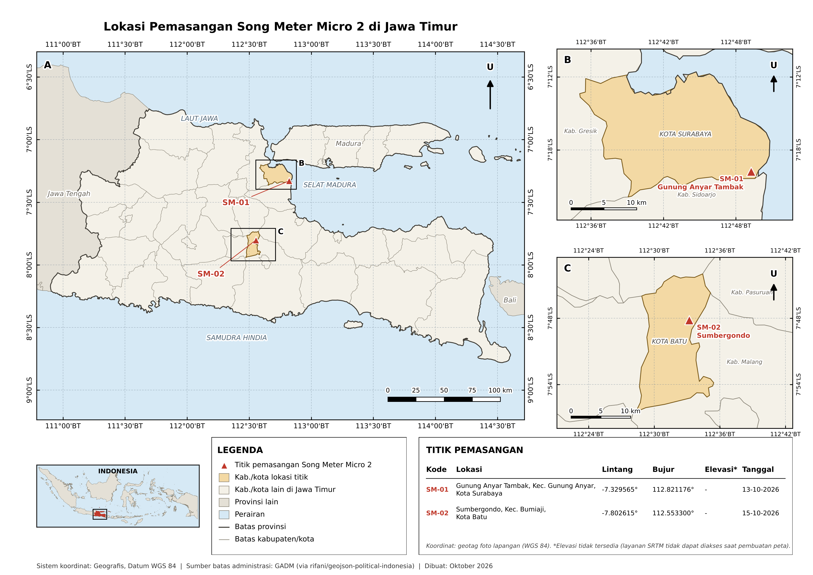

# Laporan Sementara: Pemantauan Bioakustik dengan Song Meter Micro 2
## Kegiatan Pendukung Data Bird Banding -- Program KEHATI PROPER

*Laporan sementara (interim) sebagai kegiatan pendukung (supporting
activity) untuk data bird banding dalam program keanekaragaman hayati
(KEHATI) perusahaan, untuk keperluan PROPER (Program Penilaian
Peringkat Kinerja Perusahaan dalam Pengelolaan Lingkungan Hidup,
Kementerian Lingkungan Hidup/KLHK). Bagian METODE dan TEMUAN QUALITY
CONTROL sudah final; bagian HASIL masih berisi data placeholder yang
perlu diisi dari file CSV hasil pemrosesan -- lihat catatan "[DATA
BELUM DIISI]" di tiap bagian.*

## 1. Ringkasan

Pemantauan bioakustik dilakukan di 2 lokasi di Jawa Timur menggunakan
perekam otomatis Wildlife Acoustics Song Meter Micro 2, dengan dua
jalur analisis: (1) indeks akustik soundscape (ACI, ADI, AEI, NDSI, BI,
H) dan (2) identifikasi spesies otomatis memakai model BirdNET. Total
**1.162 baris data indeks akustik** dan **23.225 deteksi spesies**
(ambang keyakinan confidence >= 0,5) berhasil diproses dari kedua
lokasi gabungan.

Satu temuan metodologis penting: proses quality control menemukan
indikasi kuat salah identifikasi untuk setidaknya satu spesies (lihat
Bagian 5), sehingga seluruh daftar spesies hasil BirdNET perlu melalui
tahap validasi sebaran geografis sebelum dipakai sebagai data final.

## 2. Latar Belakang

Program PROPER (Program Penilaian Peringkat Kinerja Perusahaan dalam
Pengelolaan Lingkungan Hidup, Kementerian Lingkungan Hidup/KLHK) menilai
kinerja pengelolaan lingkungan perusahaan, termasuk kriteria tambahan
untuk peringkat Hijau/Emas berupa program konservasi keanekaragaman
hayati (KEHATI) yang terdokumentasi dengan data pemantauan yang dapat
diverifikasi.

Salah satu metode pemantauan burung yang sudah berjalan dalam program
KEHATI adalah **bird banding** (penangkapan-penandaan burung), yang
memberi data langsung berupa identitas individu, kondisi fisik, dan
data ulang-tangkap (recapture). Metode ini punya keterbatasan cakupan
waktu (hanya terekam saat sesi penangkapan berlangsung) dan berisiko
tidak menangkap spesies yang jarang terjebak jaring/perangkap (mis.
spesies yang terbang tinggi, aktif malam, atau sangat waspada).

**Pemantauan bioakustik dengan Song Meter Micro 2** pada laporan ini
dirancang sebagai **kegiatan pendukung** (bukan pengganti) data bird
banding, dengan kontribusi yang saling melengkapi:

- **Cakupan waktu kontinu** -- alat merekam otomatis sepanjang hari
  (00:00-23:59) setiap hari, termasuk jam-jam di luar sesi bird banding
  (mis. aktivitas malam/subuh yang biasanya tidak tercakup sesi
  penangkapan siang hari).
- **Non-invasif** -- tidak perlu menangkap burung, cocok untuk
  memantau spesies yang sensitif terhadap jaring/perangkap atau untuk
  lokasi yang sulit dipasangi jaring kabut.
- **Deteksi berbasis suara** -- bisa mencatat kehadiran spesies yang
  bersuara tapi jarang/tidak pernah tertangkap bird banding (mis.
  spesies arboreal tinggi, burung malam).
- **Data kuantitatif tambahan** -- indeks akustik soundscape (ACI,
  ADI, AEI, NDSI, BI, H) memberi ukuran aktivitas/keragaman akustik
  keseluruhan di luar daftar spesies per individu, berguna sebagai
  indikator kualitas habitat yang melengkapi data bird banding.

**Catatan integrasi dengan data bird banding**: laporan ini BELUM
memuat analisis silang langsung dengan data hasil bird banding (mis.
perbandingan daftar spesies, overlap/komplemen antar metode) karena
dataset bird banding belum tersedia untuk saya proses. Begitu data
bird banding (daftar spesies, lokasi, tanggal) tersedia, bagian
pembanding itu bisa ditambahkan sebagai Bagian 6.8 -- lihat Bagian 8
(Rencana Lanjutan).

## 3. Lokasi dan Waktu Pemasangan

| Kode | Lokasi | Kecamatan | Kab./Kota | Koordinat (WGS 84) | Tipe habitat | Tanggal pasang |
| --- | --- | --- | --- | --- | --- | --- |
| SM-01 | Gunung Anyar Tambak | Kec. Gunung Anyar | Kota Surabaya | -7.329565, 112.821176 | Mangrove/tambak pesisir | 13-10-2026 |
| SM-02 | Sumbergondo | Kec. Bumiaji | Kota Batu | -7.802615, 112.553300 | Hutan dataran tinggi | 15-10-2026 |

Koordinat diambil dari geotag foto lapangan (bukan estimasi).

*Gambar 1. Peta lokasi pemasangan Song Meter Micro 2 di Jawa Timur
(gaya karya ilmiah: peta provinsi, panel detail per lokasi, inset
Indonesia, legenda, tabel koordinat). Versi vektor (PDF, cocok untuk
cetak/lampiran dokumen resmi): `outputs/figures/peta_lokasi_song_meter.pdf`.*

## 4. Metode

### 4.1 Perekaman

- **Alat**: Wildlife Acoustics Song Meter Micro 2, SN 2MM27997.
- **Setting**: sample rate 32.000 Hz, gain 18 dB, panjang rekam maksimal
  1 menit/file, duty cycle rekam 1 menit / jeda 4 menit (siklus 5
  menit), aktif 00:00-23:59 (±288 file/hari/lokasi).
- Nama file mengikuti konvensi timestamp (YYYYMMDD_HHMMSS), dipakai
  untuk merekonstruksi waktu absolut tiap deteksi.

### 4.2 Indeks Akustik Soundscape

Enam indeks dihitung per file (1 menit = 1 segmen, sesuai durasi rekam
alat) memakai package R `soundecology` dan `seewave`:

| Indeks | Interpretasi singkat |
| --- | --- |
| ACI (Acoustic Complexity Index) | Kompleksitas variasi amplitudo spektral -- proxy aktivitas biologis |
| ADI (Acoustic Diversity Index) | Keragaman energi akustik antar-pita frekuensi |
| AEI (Acoustic Evenness Index) | Kemerataan energi akustik antar-pita frekuensi |
| NDSI (Normalized Difference Soundscape Index) | Rasio dominasi suara alami (biofoni) vs antropogenik (antropofoni) |
| BI (Bioacoustic Index) | Area di bawah kurva spektrum pada pita frekuensi biologis |
| H (Acoustic Entropy) | Entropi Shannon gabungan temporal-spektral |

Skrip: `scripts/r/analisis_lengkap_audio_UT2026.R` (Bagian A).

### 4.3 Identifikasi Spesies Otomatis

Memakai package R `birdnetR` (wrapper resmi model BirdNET, Cornell Lab
/ Chemnitz University -- model dilatih antara lain dari data
xeno-canto.org). Fungsi `predict_species_from_audio_file()` dipanggil
per file dengan **ambang confidence minimum 0,5** (default package
0,1 dianggap terlalu longgar). Tiap jendela analisis 3 detik bisa
menghasilkan lebih dari satu kandidat spesies; untuk perhitungan
kekayaan/komposisi spesies, hanya kandidat **confidence tertinggi per
jendela** yang dipakai (menghindari hitung ganda kandidat alternatif).

Skrip: `scripts/r/analisis_lengkap_audio_UT2026.R` (Bagian B),
`scripts/r/rekap_spesies_song_meter.R` (pembersihan & rekap).

### 4.4 Quality Control: Validasi Sebaran Geografis

Setiap spesies yang terdeteksi disilang-cek terhadap daftar spesies
yang dianggap *plausible* oleh model lokasi BirdNET sendiri
(`birdnet_model_meta()` + `predict_species_at_location_and_time()`,
dipanggil dengan koordinat presisi tiap lokasi, tanpa filter musim).
Spesies yang terdeteksi tapi tidak masuk daftar plausible ditandai
"MENCURIGAKAN" untuk verifikasi manual lebih lanjut -- lihat Bagian 5.

Skrip: `scripts/r/validasi_sebaran_geografis_song_meter.R`.

### 4.5 Verifikasi Visual (Spektrogram)

Untuk tiap kombinasi (lokasi, spesies), satu contoh deteksi dengan
confidence tertinggi dipotong dari file WAV asli dan dibuat
spektrogram + oscillogram, untuk mendukung verifikasi visual manual
(dibandingkan referensi literatur/xeno-canto).

Skrip: `scripts/r/spektrogram_per_spesies_song_meter.R`.

### 4.6 Rincian Pengaturan (Parameter) BirdNET

Tabel berikut merangkum seluruh parameter BirdNET yang dipakai di
laporan ini, dikumpulkan dari skrip aktual (bukan dari dokumentasi
umum) supaya proses bisa direproduksi persis:

| Parameter | Nilai yang dipakai | Keterangan |
| --- | --- | --- |
| Package | `birdnetR` (R) | Wrapper resmi model BirdNET -- Cornell Lab of Ornithology / Chemnitz University. Memanggil model Python di baliknya lewat `reticulate`. |
| Model deteksi spesies | `birdnet_model_protobuf()` | Model akustik BirdNET standar (klasifikasi suara -> spesies per jendela 3 detik). |
| Model validasi sebaran geografis | `birdnet_model_meta()` | Model terpisah (metadata lokasi/musim), dipakai hanya untuk quality control Bagian 4.4 -- bukan untuk deteksi spesies dari audio. |
| Fungsi pemanggil deteksi | `predict_species_from_audio_file(model, path_file, min_confidence = ...)` | Dipanggil satu kali per file `.wav`; kolom hasil terkonfirmasi lewat uji langsung ke data asli: `start`, `end`, `scientific_name`, `common_name`, `confidence`. |
| **Ambang keyakinan minimum (`min_confidence`)** | **0,5** | Default bawaan package adalah 0,1 (dianggap terlalu longgar/banyak false positive) -- dinaikkan ke 0,5 sebagai titik awal yang lebih aman untuk menyaring deteksi. Ambang ini memengaruhi langsung jumlah & komposisi spesies yang lolos (lihat sensitivitas di Bagian 6.7). |
| Panjang jendela analisis | 3 detik (bawaan model BirdNET, tidak bisa diubah) | 1 file rekaman 1 menit di lapangan menghasilkan ±20 jendela analisis berurutan. |
| `week` (filter musim) pada `predict_species_at_location_and_time()` | **Tidak diisi / NULL** (sengaja dikosongkan) | Supaya daftar spesies "plausible" per lokasi mencakup kemungkinan sepanjang tahun, bukan hanya musim saat perekaman -- menghindari menyaring terlalu ketat spesies migran yang mungkin memang sedang lewat. |
| Koordinat lokasi untuk validasi sebaran geografis | Koordinat presisi tiap lokasi (lihat tabel Bagian 3) | Dipakai persis sebagai argumen `latitude`/`longitude` ke `predict_species_at_location_and_time()`. |
| Parameter lain package (mis. `overlap`, `sensitivity`, daftar spesies kustom) | **Tidak diubah -- nilai default package** | Skrip tidak meng-override parameter ini secara eksplisit; nilai persisnya mengikuti versi `birdnetR` yang terpasang saat proses dijalankan (lihat rekomendasi reproduksibilitas di bawah). |

**Rekomendasi untuk reproduksibilitas**: catat `packageVersion("birdnetR")`
dan tanggal unduh model (model BirdNET bisa diperbarui dari waktu ke
waktu oleh pengembang) saat proses akhir dijalankan di komputer
lapangan, lalu cantumkan di laporan final -- supaya hasil bisa
dibandingkan apple-to-apple kalau analisis diulang di masa depan
dengan versi model yang berbeda.

Skrip sumber kedua pemanggilan di atas: `scripts/r/analisis_lengkap_audio_UT2026.R`
(Bagian B, deteksi spesies) dan `scripts/r/validasi_sebaran_geografis_song_meter.R`
(validasi sebaran geografis).

## 5. Temuan Quality Control: Indikasi Salah Identifikasi

Saat peninjauan awal hasil, ditemukan deteksi atas nama **Takur
Warna-warni** (*Psilopogon mystacophanos*, nama Inggris Red-throated
Barbet) di lokasi SM-01 (Gunung Anyar Tambak, Surabaya). Sebaran alami
spesies ini dikenal ke arah Sumatra dan Kalimantan, bukan Jawa --
sehingga dicurigai sebagai salah identifikasi (kemungkinan tertukar
dengan takur sejenis yang memang ada di Jawa, mengingat kemiripan
panggilan antar-spesies *Psilopogon*).

**Verifikasi lewat model lokasi BirdNET sendiri mengonfirmasi
kecurigaan ini**: dari 369 spesies yang dianggap *plausible* muncul di
koordinat SM-01 (dihitung model `birdnet_model_meta()`), *Psilopogon
mystacophanos* **tidak termasuk** di dalamnya.

**Implikasi metodologis**: seluruh daftar spesies hasil BirdNET di
laporan ini WAJIB melalui tahap validasi sebaran geografis (Bagian
4.4) sebelum dipakai sebagai data final -- deteksi otomatis tanpa
validasi berisiko memuat kesalahan identifikasi seperti kasus ini.

## 6. Hasil

### 6.1 Ringkasan Volume Data

| Variabel | Nilai |
| --- | --- |
| Total baris indeks akustik (semua lokasi) | 1.162 |
| Total deteksi spesies (confidence >= 0,5, sebelum dedup kandidat) | 23.225 |
| Jumlah lokasi | 2 |

### 6.2 Kekayaan & Keragaman Spesies per Lokasi

**[DATA BELUM DIISI]** -- isi dari `ringkasan_kekayaan_spesies.csv`
(hasil `rekap_spesies_song_meter.R`): kekayaan spesies (S), total
deteksi bersih, indeks Shannon-Wiener (H'), evenness (J) per lokasi.

| Lokasi | Kekayaan spesies (S) | Total deteksi (bersih) | Shannon-H' | Evenness (J) |
| --- | --- | --- | --- | --- |
| SM-01 Gunung Anyar Tambak | *(isi)* | *(isi)* | *(isi)* | *(isi)* |
| SM-02 Sumbergondo | *(isi)* | *(isi)* | *(isi)* | *(isi)* |

### 6.3 Daftar Spesies Teridentifikasi

**[DATA BELUM DIISI]** -- isi dari `tabel_spesies_lengkap_semua_lokasi.csv`
(hasil `tabel_spesies_per_lokasi.R`). **Setelah divalidasi** lewat
`validasi_sebaran_geografis_song_meter.R` -- tandai spesies
"MENCURIGAKAN" secara eksplisit di tabel final, jangan dihapus diam-diam.

### 6.4 Perbandingan Antar Lokasi

**[DATA BELUM DIISI]** -- isi dari `hasil_uji_perbandingan_lokasi.csv`
(hasil `perbandingan_lokasi_song_meter.R`): median tiap indeks akustik
& kekayaan spesies per lokasi, hasil uji Wilcoxon (p-value, signifikan
atau tidak).

### 6.5 Korelasi Indeks Akustik vs Kekayaan Spesies

**[DATA BELUM DIISI]** -- isi dari `hasil_korelasi_indeks_kekayaan.csv`
(hasil `korelasi_indeks_kekayaan_song_meter.R`): koefisien Spearman
per indeks, apakah signifikan sebagai proxy biodiversitas.

### 6.6 Pola Aktivitas Diel

**[DATA BELUM DIISI]** -- ringkasan naratif dari
`heatmap_diel_<lokasi>.png` (hasil `pola_diel_spesies_song_meter.R`):
jam aktivitas puncak per lokasi, spesies dominan di tiap periode.

### 6.7 Kurva Akumulasi Spesies & Sensitivitas Ambang

**[DATA BELUM DIISI]** -- ringkasan dari
`kurva_akumulasi_spesies.csv`/`.png` dan
`sensitivitas_ambang_confidence.csv`/`.png` (hasil
`analisis_lanjutan_song_meter.R`): apakah durasi survei sudah cukup
menangkap kekayaan spesies, dan seberapa sensitif hasil terhadap
pemilihan ambang confidence.

## 7. Keterbatasan

- **Durasi survei pendek** (deployment baru dimulai 13 & 15 Oktober
  2026) -- hasil di laporan ini bersifat sementara/awal, bukan
  representasi tahunan/musiman penuh.
- **BirdNET tidak punya nama umum Bahasa Indonesia** -- nama Indonesia
  di tabel spesies dicocokkan dari referensi 235 spesies burung
  air/pantai proyek lain (cakupan terbatas, banyak spesies hutan di
  SM-02 kemungkinan tidak ketemu padanannya).
- **Deteksi otomatis berpotensi salah** (lihat Bagian 5) -- validasi
  sebaran geografis adalah mitigasi, bukan jaminan 100% akurat; untuk
  publikasi formal, spesies penting/baru-tercatat sebaiknya
  diverifikasi manual lewat spektrogram + referensi audio.
- **NDSI yang dipakai adalah nilai gabungan**, bukan komponen biofoni/
  antropofoni terpisah.
- Hanya 2 lokasi -- uji statistik antar-lokasi (Bagian 6.4) punya
  kekuatan terbatas untuk generalisasi ke skala lebih luas.

## 8. Rencana Lanjutan

1. Lengkapi Bagian 6 dengan data CSV aktual dari komputer lapangan.
2. Verifikasi manual semua spesies berstatus "MENCURIGAKAN" lewat
   spektrogram + perbandingan xeno-canto.
3. Lanjutkan pemantauan untuk memperpanjang durasi survei (lihat kurva
   akumulasi spesies, Bagian 6.7).
4. Pertimbangkan menambah lokasi untuk memperkuat perbandingan
   antar-habitat.
5. **Integrasikan dengan data bird banding** (Bagian 2): bandingkan
   daftar spesies hasil akustik vs hasil penangkapan -- identifikasi
   spesies yang hanya terekam salah satu metode (saling melengkapi)
   vs yang terekam keduanya (saling menguatkan/validasi silang), untuk
   memperkuat bukti pemantauan KEHATI pada dokumen PROPER.

## 9. Lampiran: Skrip & Berkas Terkait

- `scripts/r/analisis_lengkap_audio_UT2026.R` -- indeks akustik + identifikasi spesies (proses utama)
- `scripts/r/rekap_spesies_song_meter.R` -- pembersihan & rekap kekayaan/keragaman
- `scripts/r/pola_diel_spesies_song_meter.R` -- heatmap aktivitas diel
- `scripts/r/perbandingan_lokasi_song_meter.R` -- uji Wilcoxon antar lokasi
- `scripts/r/korelasi_indeks_kekayaan_song_meter.R` -- korelasi Spearman
- `scripts/r/analisis_lanjutan_song_meter.R` -- akumulasi spesies, sensitivitas ambang, pola NDSI per jam
- `scripts/r/tabel_spesies_per_lokasi.R` -- tabel nama ilmiah/Indonesia/Inggris
- `scripts/r/validasi_sebaran_geografis_song_meter.R` -- quality control sebaran geografis
- `scripts/r/spektrogram_per_spesies_song_meter.R` -- spektrogram verifikasi visual
- `scripts/python/peta_lokasi_song_meter.py` -- peta lokasi titik pemasangan
- `outputs/figures/peta_lokasi_song_meter.png` / `.pdf` -- peta lokasi
